 

 

I'm a second-year **BSc Honours ICT (Software Engineering)** student at **Arrupe Jesuit University** in Harare. I design, build and secure database-backed web apps, and I like owning a system from first sketch to handover. Outside of that I'm deep into AI from scratch, game dev and low-level systems programming.

  

  

<table>
<tr>
<td width="33%" valign="top">

### 🧠 Aria AI
Decoder-only transformer LLM built from scratch: BPE tokenisation, multi-head causal attention, RMSNorm, and a FineWeb-Edu data pipeline.

`Python` `PyTorch-style from scratch`

</td>
<td width="33%" valign="top">

### 🏦 [Banking Transaction Engine](https://github.com/andlskyfallaju)
Socket-based client-server system for concurrent deposits and withdrawals, with a JDBC ledger, rollback on failure, Strategy pattern for fees, Observer pattern for high-value alerts, and a web interface.

`Java` `JDBC` `Sockets`

</td>
<td width="33%" valign="top">

### ⚡ [cpugpurender](https://github.com/andlskyfallaju/cpugpurender)
Software renderer that simulates GPU shader execution on the CPU using SIMD parallelism.

`C++` `SIMD`

</td>
</tr>
<tr>
<td valign="top">

### 🎵 Skyfall Music Player
Cross-platform music app that streams and downloads audio through the YouTube API.

`Flutter` `Dart` `YouTube API`

</td>
<td valign="top">

### 🎓 DS4Y Attendance &amp; Registration Portal
Built at Impact Hub Harare: role-based access, attendance and enrolment forms, a filterable staff dashboard with Excel export, laptop tracking, and a hardened security layer. The organisation now runs on it.

`PHP` `JavaScript` `SQLite`

</td>
<td valign="top">

### 🕹️ [Game Portfolio Site](https://github.com/andlskyfallaju/Game-Portfolio-Site)
Pixel-art, top-down portfolio you walk around in with WASD, in a cozy developer room.

`JavaScript`

</td>
</tr>
<tr>
<td valign="top">

### 🗡️ [DungeonEscape](https://github.com/andlskyfallaju/DungeonEscape)
2D dungeon raid game, my ICT 2.1 end-of-semester project.

`Java`

</td>
<td valign="top">

### 📱 [MindaPriceZW](https://github.com/andlskyfallaju/mindaprice-zw-app)
Mobile app plus a [backend](https://github.com/andlskyfallaju/mindaprice-backend) running on Render with a CronJob.

`Dart` `JavaScript`

</td>
<td valign="top">

### 🏫 [School System](https://github.com/andlskyfallaju/School-System-By-Skyfall)
Database-linked online form for adding students to a school system.

`PHP` `MySQL`

</td>
</tr>
</table>

 

- **IT Support & Digital Operations Assistant**, Ayandile Knowledge Hub (Apr 2026 – present): IT support, web content, webinar systems and participant engagement for a renewable energy and climate finance platform.
- **ICT Service Programme Intern**, Impact Hub Harare (May – Jul 2026): self-initiated and built the DS4Y portal end to end, then wrote the handover document. Also completed a 100-hour service programme: fixed website links, built a reusable newsletter template, digitised physical records.
- **Evoke Hackathon, 2nd place** (World Bank × Impact Hub), Team 2nd LIFE: *E-Waste Reclaimers: Harare's Scrap Hunters*, a graphic-novel story and pitch deck for a circular economy for e-waste.
- **Leadership:** former ICT Club President and Cricket Vice-Captain at St John's High School.

| 🎓 Education | 🏅 Certifications |
|:--|:--|
| **BSc ICT (Software Engineering)**, Arrupe Jesuit University, 2025 – present | Google: *Foundations of Cybersecurity* (Jun 2026) |
| Coursework: Database Design, OOP, OOAD, Network Design & Implementation | Google: *Play It Safe: Manage Security Risks* (Jun 2026) |
| **Cambridge A-Level** (Geography, Biology, IT), St John's High School | Google: *Agile Project Management* (Jun 2026) |
| | LinkedIn: *Cybersecurity Awareness* (Terminology, Ransomware) (Apr 2026) |
| | HP LIFE: *AI* (Dec 2025) |

 

 

Looking for a **software or web development internship** in Harare, or happy to just talk projects.

